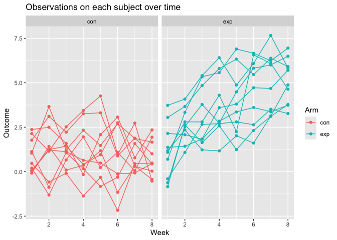
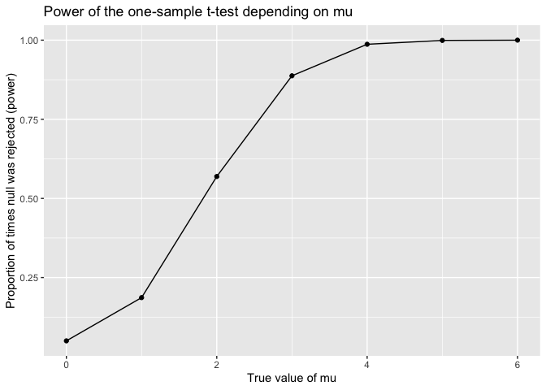
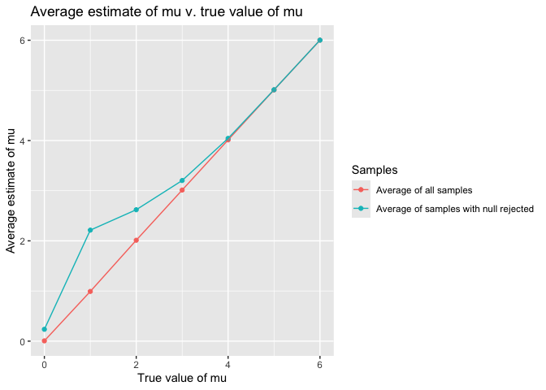

Homework 5
================
Ananya Lahiri
2026-11-18

# Problem 1

``` r
# Check for duplicate birthdays
birthday = function(n) { 
sim_data = sample(1:365, n, replace = TRUE)
num_bday = n_distinct(sim_data)
num_bday < n
}

# Run function 10,000 times from groups between 2 & 50
sim_results_df = expand_grid(sample_size = 2:50, iter = 1:10000) |>
mutate(duplicate = map(sample_size, birthday)) |>
unnest(duplicate)
head(sim_results_df)
```

    ## # A tibble: 6 × 3
    ##   sample_size  iter duplicate
    ##         <int> <int> <lgl>    
    ## 1           2     1 FALSE    
    ## 2           2     2 FALSE    
    ## 3           2     3 FALSE    
    ## 4           2     4 FALSE    
    ## 5           2     5 FALSE    
    ## 6           2     6 FALSE

``` r
#Probability that at least 2 people share a birthday
sim_results_df |>
group_by(sample_size) |>
summarize(emp_mean = mean(duplicate)) |>
ggplot(aes(x = sample_size, y = emp_mean)) + geom_point() + 
geom_line() + 
labs(
title = "Probability that at least 2 people share a birthday", 
x = "group size", 
y = "Probability of shared birthday"
)
```

<!-- -->

Sample() was used to draw a random birthday for each person in a group.
Then n_distinct() was used to check if any birthdays were repeated. We
got TRUE as the answer if at least two people shared a birthday, and
FALSE if not. Then expand_grid() and map() were used to run the function
10,000 times for each group size between 2 and 50. Group_by() and
summarize() were then used to find the probability of finding a shared
birthday by finding the average across the 10,000 runs.

As seen in the plot, the probability of having a shared birthday
increases as the group size increases. The probability is close to 0 for
smaller groups and was approximately 0.98 for groups of 50 people.

# Problem 2

``` r
# Creating dataframe with all file names
full_df = tibble(
files = list.files("data/"), path = str_c("data/", files)) |>
mutate(data = map(path, read_csv)) |>
unnest(data)
head(full_df)
```

    ## # A tibble: 6 × 10
    ##   files      path        week_1 week_2 week_3 week_4 week_5 week_6 week_7 week_8
    ##   <chr>      <chr>        <dbl>  <dbl>  <dbl>  <dbl>  <dbl>  <dbl>  <dbl>  <dbl>
    ## 1 con_01.csv data/con_0…   0.2   -1.31   0.66   1.96   0.23   1.09   0.05   1.94
    ## 2 con_02.csv data/con_0…   1.13  -0.88   1.07   0.17  -0.83  -0.31   1.58   0.44
    ## 3 con_03.csv data/con_0…   1.77   3.11   2.22   3.26   3.31   0.89   1.88   1.01
    ## 4 con_04.csv data/con_0…   1.04   3.66   1.22   2.33   1.47   2.7    1.87   1.66
    ## 5 con_05.csv data/con_0…   0.47  -0.58  -0.09  -1.37  -0.32  -2.17   0.45   0.48
    ## 6 con_06.csv data/con_0…   2.37   2.5    1.59  -0.16   2.08   3.07   0.78   2.35

``` r
# Tidy data
tidy_df =
full_df |>
mutate(
files = str_replace(files, ".csv", ""),
arm = str_sub(files, 1, 3)) |>
pivot_longer(
week_1:week_8,
names_to = "week",
values_to = "outcome",
names_prefix = "week_") |>
mutate(week = as.numeric(week)) |> 
select(arm, subject_id = files, week, outcome)

head(tidy_df)
```

    ## # A tibble: 6 × 4
    ##   arm   subject_id  week outcome
    ##   <chr> <chr>      <dbl>   <dbl>
    ## 1 con   con_01         1    0.2 
    ## 2 con   con_01         2   -1.31
    ## 3 con   con_01         3    0.66
    ## 4 con   con_01         4    1.96
    ## 5 con   con_01         5    0.23
    ## 6 con   con_01         6    1.09

``` r
# Make a spaghetti plot of observations on each subject over time
tidy_df |>
ggplot(aes(x = week, y = outcome, group = subject_id, color = arm)) + 
geom_point() + 
geom_path() + 
facet_grid(~arm) +
labs(title = "Observations on each subject over time", 
x = "Week",
y = "Outcome",
color = "Arm")
```

<!-- -->

List.files() was used to make the data frame with all of the file names,
and map() and read_csv() were used to get the data for each subject.
Str_replace() and str_sub() were then used to get the subject ID and arm
from the file names, and pivot_longer() was used to tidy each of the
weekly observations, so each row had one subject per week. As seen in
the spaghetti plot, individuals in the control arm had relatively
constant outcomes between -2.5 and ~4 over the 8-week time period. In
the experimental arm, individuals increased from 0 to 3 in the first
week to 3 to ~7 at the end of the 8 weeks. Therefore, the experimental
arm had higher outcomes on average compared to the control arm.

# Problem 3

``` r
# Set up simulation to explore power in 1-sample t-test
sim_ttest = function(mu, n = 30, sigma = 5) {
sim_data = tibble(
x = rnorm(n, mean = mu, sd = sigma)
)
sim_data |>
pull(x) |>
t.test(mu = 0) |>
broom::tidy() |>
select(estimate, p.value)
}

#Test function
sim_ttest(0)
```

    ## # A tibble: 1 × 2
    ##   estimate p.value
    ##      <dbl>   <dbl>
    ## 1    -1.62  0.0545

``` r
sim_ttest(6)
```

    ## # A tibble: 1 × 2
    ##   estimate    p.value
    ##      <dbl>      <dbl>
    ## 1     5.46 0.00000277

``` r
# Generate 5000 datasets for mu = {1,..,6}
sim_results_df = expand_grid(
true_mu = 0:6,
iter = 1:5000) |>
mutate(estimate_df = map(true_mu, sim_ttest)) |>
unnest(estimate_df)
head(sim_results_df)
```

    ## # A tibble: 6 × 4
    ##   true_mu  iter estimate p.value
    ##     <int> <int>    <dbl>   <dbl>
    ## 1       0     1  -0.278    0.767
    ## 2       0     2  -0.303    0.733
    ## 3       0     3   0.406    0.637
    ## 4       0     4   0.147    0.881
    ## 5       0     5   1.20     0.191
    ## 6       0     6  -0.0542   0.957

``` r
# Make a plot for the power of the test
sim_results_df |>
group_by(true_mu) |>
summarize(power = mean(p.value < 0.05)) |>
ggplot(aes(x = true_mu, y = power)) + geom_point() + geom_line() +
labs(
title = "Power of the one-sample t-test depending on mu",
x = "True value of mu",
y = "Proportion of times null was rejected (power)"
)
```

<!-- -->

Group_by() and summarize() were used in order to find the power of each
value of mu. This was done by running 5,000 tests and looking at the
proportion of tests where the null was rejected. This was done when the
p-value was less than the alpha value of 0.05. As seen in the plot, as
the true value of mu (which is the effect size) increases, the power
increases.

``` r
# Average estimate and true value of mu
mu_df = sim_results_df |>
group_by(true_mu) |>
summarize(avg_mu = mean(estimate)) |>
mutate(samples = "Average of all samples")

# Average estimate of mu for samples with null rejected
null_rejected_df = sim_results_df |>
filter(p.value < 0.05) |>
group_by(true_mu) |>
summarize(avg_mu = mean(estimate)) |>
mutate(samples = "Average of samples with null rejected")

#Overlay plots 
bind_rows(mu_df, null_rejected_df) |>
ggplot(aes(x = true_mu, y = avg_mu, color = samples)) + geom_point() + geom_line() + labs(
title = "Average estimate of mu v. true value of mu", 
x = "True value of mu",
y = "Average estimate of mu",
color = "Samples"
)
```

<!-- -->

As seen in the plot above, the average estimate of mu in the samples
where the null was rejected was fairly consistent with the average of
all the samples where mu was 4 or larger. However, for values of mu that
are below 4, the average of samples where the null was rejected was
higher than the true value of mu, which is where we see the gap in the
lines. This is because the power is low for these values of mu, and
since the mu is small, the null is only rejected when a sample has a
high estimate, leading to a larger average. When mu is larger, most
samples rejected the null, leading to averages that are similar to each
other.
