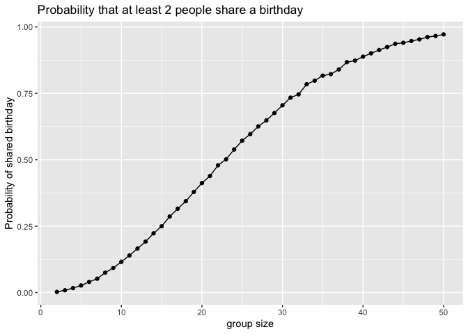

Homework 5
================
Ananya Lahiri
2026-11-18

# Problem 1

``` r
# Check for duplicate birthdays
birthday = function(n) { 
sim_data = sample(1:365, n, replace = TRUE)
num_bday = n_distinct(sim_data)
num_bday < n
}

# Run function 10,000 times from groups between 2 & 50
sim_results_df = expand_grid(sample_size = 2:50, iter = 1:10000) |>
mutate(duplicate = map(sample_size, birthday)) |>
unnest(duplicate)
head(sim_results_df)
```

    ## # A tibble: 6 × 3
    ##   sample_size  iter duplicate
    ##         <int> <int> <lgl>    
    ## 1           2     1 FALSE    
    ## 2           2     2 FALSE    
    ## 3           2     3 FALSE    
    ## 4           2     4 FALSE    
    ## 5           2     5 FALSE    
    ## 6           2     6 FALSE

``` r
#Probability that at least 2 people share a birthday
sim_results_df |>
group_by(sample_size) |>
summarize(emp_mean = mean(duplicate)) |>
ggplot(aes(x = sample_size, y = emp_mean)) + geom_point() + 
geom_line() + 
labs(
title = "Probability that at least 2 people share a birthday", 
x = "group size", 
y = "Probability of shared birthday"
)
```

<!-- -->
Sample() was used to draw a random birthday for each person in a group.
Then n_distinct() was used to check if any birthdays were repeated. We
got TRUE as the answer if at least two people shared a birthday, and
FALSE if not. Then expand_grid() and map() were used to run the function
10,000 times for each group size between 2 and 50. Group_by() and
summarize() were then used to find the probability of finding a shared
birthday by finding the average across the 10,000 runs.

As seen in the plot, the probability of having a shared birthday
increases as the group size increases. The probability is close to 0 for
smaller groups and was approximately 0.98 for groups of 50 people.
